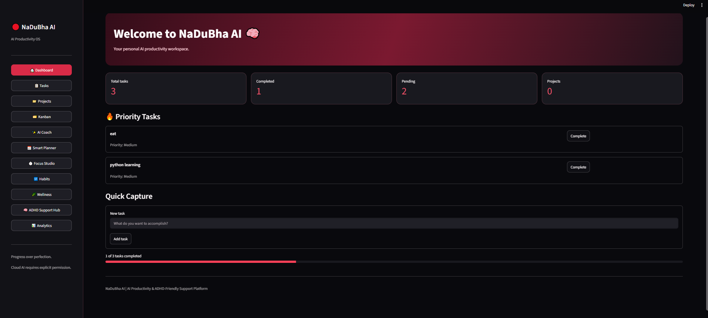
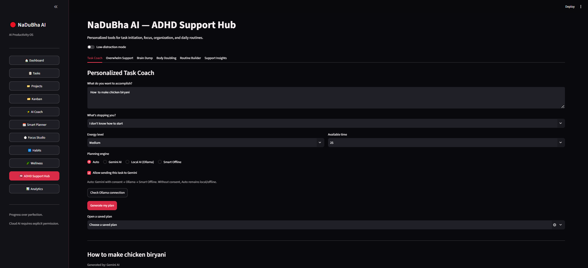
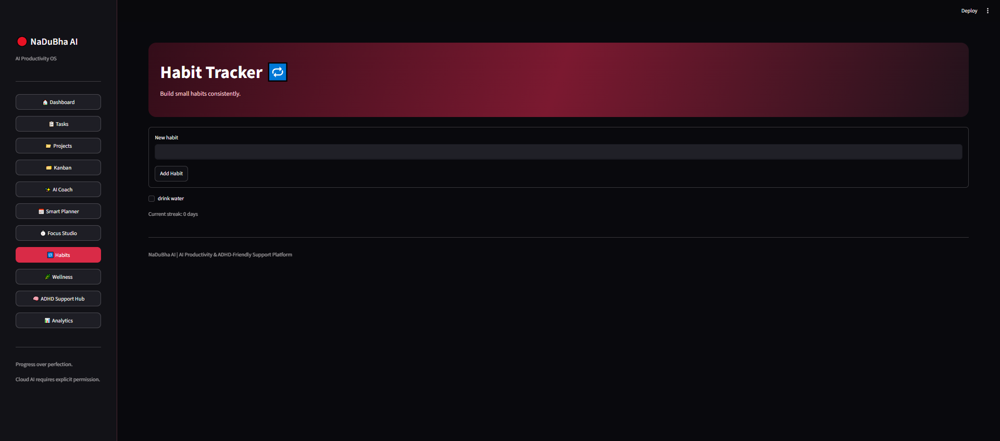
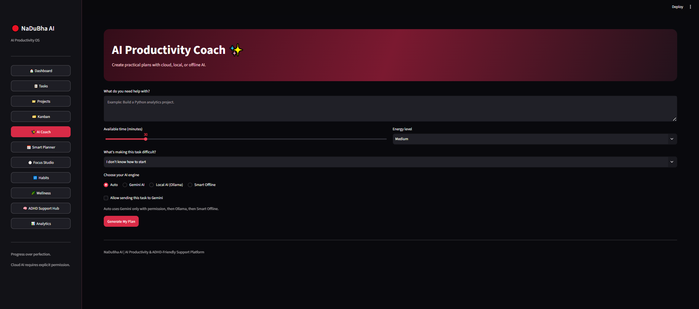
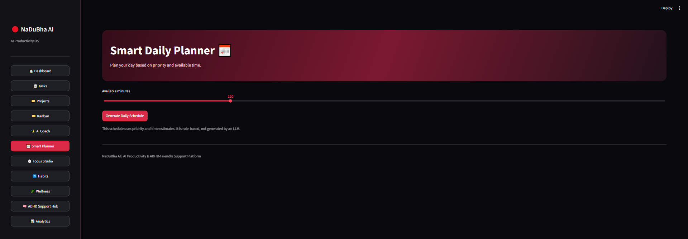
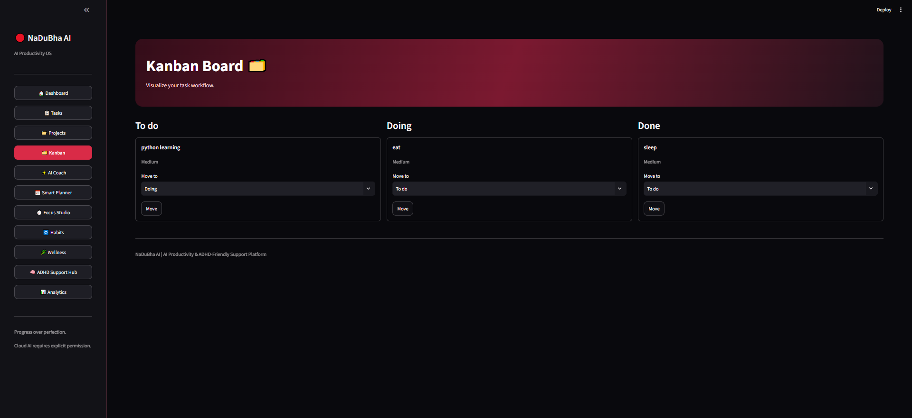
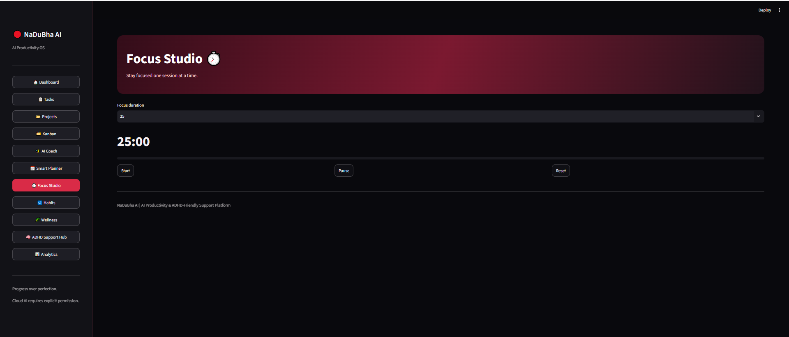
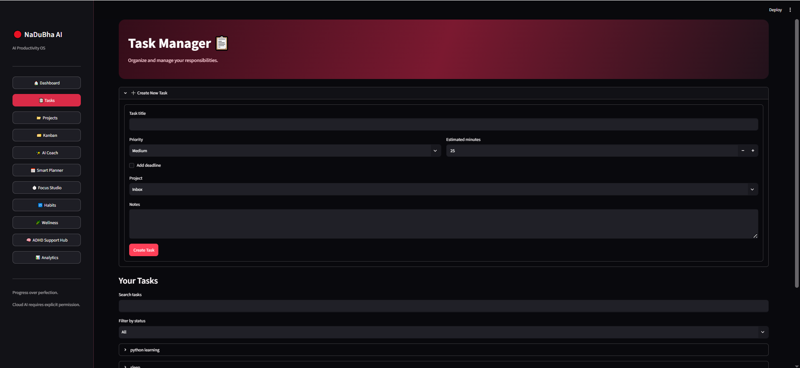
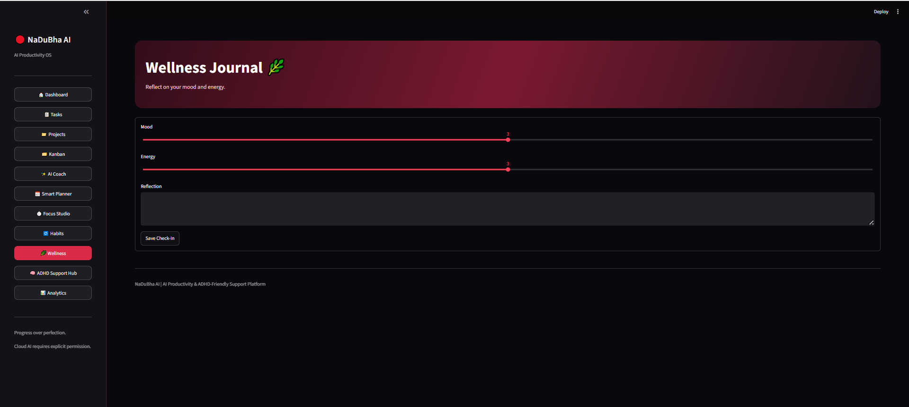
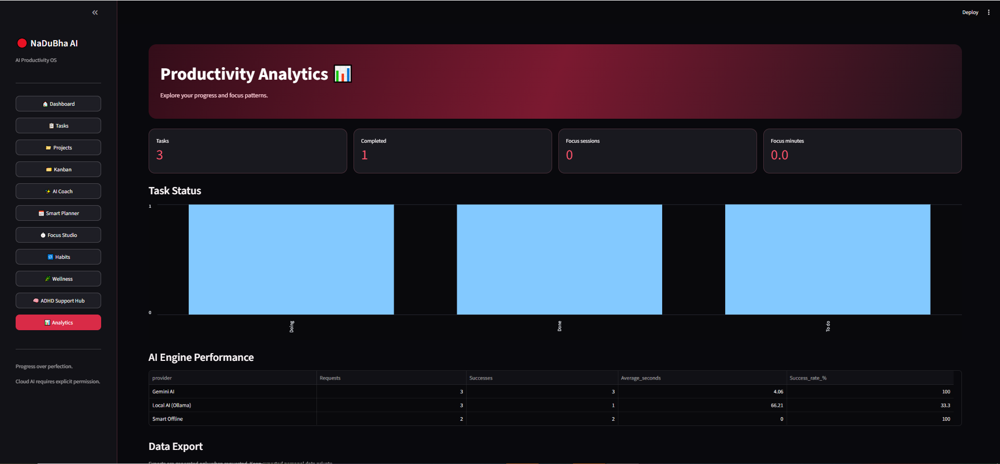

 
<div align="center">

# 🧠 NaDuBha AI

### Your Intelligent Productivity & Focus Companion

**An AI-powered productivity workspace designed to make task management, planning, focus, and daily routines simpler and more personalized.**

Built with Python, Streamlit, SQLite, Google Gemini, and Ollama.


**Plan smarter • Focus better • Track progress • Build consistency**

</div>

---

## ✨ Overview

**NaDuBha AI** is a personal productivity application combining traditional task-management tools with AI-assisted planning and ADHD-friendly productivity support.

Instead of simply storing tasks, NaDuBha AI helps users break down overwhelming work, prioritize responsibilities, structure focus sessions, develop routines, and understand their productivity patterns.

The platform supports three planning approaches: cloud-based AI using Google Gemini, local AI using Ollama, and a built-in offline planning engine.

## 🚀 Features

### 🏠 1. Interactive Dashboard
- View total, completed, and pending tasks.
- Identify high-priority work.
- Capture new tasks quickly.
- Monitor overall task completion.

### 📋 2. Advanced Task Manager
- Create and organize tasks.
- Set priorities, deadlines, and time estimates.
- Attach notes and associate tasks with projects.
- Update task status and track completion.
- Search, filter, and delete tasks.

### 📁 3. Project Management
- Create projects with descriptions.
- Group related tasks under projects.
- Track project progress through completion indicators.

### 🗂️ 4. Kanban Workflow
- Visualize tasks across **To do**, **Doing**, and **Done**.
- Move tasks between workflow stages.
- Organize daily work visually.

### ✨ 5. AI Productivity Coach
- Generate personalized, step-by-step action plans.
- Adapt recommendations to available time, energy, and current obstacles.
- Break complex tasks into smaller, actionable steps.
- View the AI provider and generation time.

### 🤖 6. Multi-Engine AI Architecture

| Engine | Purpose |
|---|---|
| Google Gemini | Cloud-based personalized task planning |
| Ollama | Local AI inference |
| Smart Offline | Rule-based planning without an external model |
| Auto | Selects an available planning engine with fallback support |

Cloud task transmission requires explicit user consent.

### 📅 7. Smart Daily Planner
- Prioritize tasks based on urgency and importance.
- Allocate work into available time.
- Include short breaks.
- Generate structured daily schedules.

### ⏱️ 8. Focus Studio
- Start, pause, and reset focus timers.
- Choose different focus durations.
- Track completed sessions.
- Review focus activity in analytics.

### 🔁 9. Habit Tracker
- Create daily habits.
- Mark habits complete.
- Track consecutive-day streaks.

### 🌿 10. Wellness Journal
- Record daily mood and energy levels.
- Add personal reflections.
- Visualize trends over time.

### 🧠 11. ADHD-Friendly Support Hub

The dedicated support hub provides six tools:

**Personalized Task Coach:** Break tasks into achievable steps based on obstacles, energy, and available time. Save plans, check off completed steps, and record reflections.

**Overwhelm Support:** Identify a manageable next action when a task feels difficult.

**Brain Dump:** Capture thoughts quickly and convert them into actionable tasks.

**Guided Focus Sessions:** Use structured timers and save work-session reflections.

**Flexible Routine Builder:** Create manageable routines with breaks and time blocks.

**Support Insights:** Explore task progress, focus sessions, reflections, and AI engine performance.

These features provide productivity support and are not intended to diagnose or treat ADHD.

### 📊 12. Productivity Analytics
- Track completed and pending tasks.
- Analyze focus sessions from multiple modules.
- Review daily focus activity.
- Compare AI engine success rates and response times.
- Export selected data to CSV.

---

## 📸 NaDuBha AI — Application Preview

###  Productivity Dashboard


###  ADHD Support Hub


###  Habit Tracker


###  AI Productivity Coach


###  Smart Planner


###  Kanban Task Board


###  Focus Studio


###  Tasks


###  Wellness Journal


###  Analytics



  
## 🏗️ System Architecture

```text
                    ┌──────────────────────┐
                    │      NaDuBha AI      │
                    │     Streamlit UI     │
                    └──────────┬───────────┘
                               │
          ┌────────────────────┼────────────────────┐
          │                    │                    │
          ▼                    ▼                    ▼
  ┌──────────────┐    ┌────────────────┐    ┌─────────────────┐
  │ Productivity │    │   AI Planning  │    │ ADHD Support    │
  │ Modules      │    │   Engine       │    │ Hub             │
  └──────┬───────┘    └───────┬────────┘    └────────┬────────┘
         │                    │                      │
         │           ┌────────┼────────┐             │
         │           ▼        ▼        ▼             │
         │        Gemini   Ollama   Offline          │
         │           │        │        │             │
         └───────────┴────────┴────────┴─────────────┘
                              │
                              ▼
                    ┌──────────────────┐
                    │ SQLite Database  │
                    │ Tasks / Habits   │
                    │ Plans / Metrics  │
                    └──────────────────┘
```

---

## 🛠️ Technology Stack

| Category | Technology |
|---|---|
| Programming language | Python |
| Frontend | Streamlit |
| Database | SQLite |
| Data processing | Pandas |
| Cloud AI | Google Gemini |
| Local AI | Ollama |
| Offline planning | Python rule-based logic |
| Configuration | python-dotenv |
| Version control | Git and GitHub |

---

## 📂 Project Structure

```text
nadubha-ai/
│
├── app.py
├── adhd_hub.py
├── check_models.py
├── test_gemini.py
├── requirements.txt
├── .env.example
├── .gitignore
├── README.md
│
└── .streamlit/
    └── config.toml
```

**Main application:** `app.py`

**ADHD-friendly tools and AI planning:** `adhd_hub.py`

**Model diagnostics:** `check_models.py` and `test_gemini.py`

**Application dependencies:** `requirements.txt`

**Streamlit configuration:** `.streamlit/config.toml`

---

## ⚙️ Installation and Setup

### 1. Clone the repository

```bash
git clone https://github.com/KrishiJyothirmaiV/nadubha-ai.git
cd nadubha-ai
```

Replace `YOUR_USERNAME` with your GitHub username.

### 2. Create a virtual environment

```bash
python -m venv .venv
```

Activate it on Windows:

```powershell
.\.venv\Scripts\Activate.ps1
```

### 3. Install dependencies

```bash
pip install -r requirements.txt
```

### 4. Configure environment variables

Create a `.env` file in the project directory.

```env
GEMINI_API_KEY=your_gemini_api_key
GEMINI_MODEL=gemini-2.5-flash

OLLAMA_URL=http://127.0.0.1:11434
OLLAMA_MODEL=llama3.2:3b
OLLAMA_TIMEOUT=90
```

Never commit your real `.env` file or API keys to GitHub.

### 5. Optional: Set up Ollama

Install Ollama from https://ollama.com.

Download the configured model:

```bash
ollama pull llama3.2:3b
```

Ensure the local Ollama service is running before selecting the Ollama AI engine.

### 6. Run NaDuBha AI

```bash
streamlit run app.py --server.port 8503
```

Open:

**http://localhost:8503**

---

## 🔐 Privacy and Security

NaDuBha AI includes several privacy-conscious design choices:

- Environment variables are used for API credentials.
- `.gitignore` excludes local secrets and SQLite database files.
- Gemini cloud processing requires explicit user consent.
- Local Ollama inference and offline planning are available.
- User task and productivity records are stored in a local SQLite database.

**Security note:** The project is intended as a local prototype. It has not undergone a formal security audit, and authentication or multi-user access controls would be required before exposing personal data through a public deployment.

---

## 📸 Application Screenshots

Screenshots can be added here as the application UI is finalized.

Suggested screenshots:
- Dashboard
- AI Productivity Coach
- Kanban Board
- ADHD Support Hub
- Focus Studio
- Productivity Analytics

---

## 🗺️ Future Roadmap

- [ ] Add automated tests and continuous integration.
- [ ] Improve database migrations and schema compatibility.
- [ ] Improve local AI performance and response handling.
- [ ] Add AI-assisted weekly productivity summaries.
- [ ] Introduce calendar integrations.
- [ ] Improve mobile responsiveness.
- [ ] Add secure user authentication for multi-user deployment.
- [ ] Expand accessibility and low-distraction options.
- [ ] Support optional cloud synchronization.

---

## 💡 Project Motivation

NaDuBha AI was created to explore how AI, practical software engineering, and productivity analytics can work together in a useful everyday application.

The project demonstrates Python application development, Streamlit UI design, local data persistence, AI API integration, local LLM inference, fallback logic, and analytics-oriented feature development.

---

## 👩‍💻 Developer

**Krishi Jyothirmai Vadaparthi**

*Data Analytics | Python | Artificial Intelligence | Application Development*

---

<div align="center">

### 🧠 NaDuBha AI

**Small steps. Meaningful progress. Smarter productivity.**

Built with Python, AI, and a focus on practical usability.

</div>
